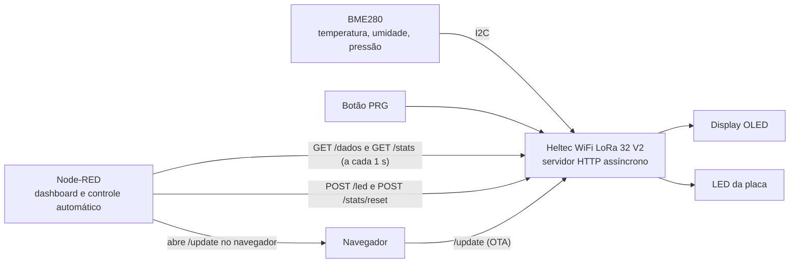
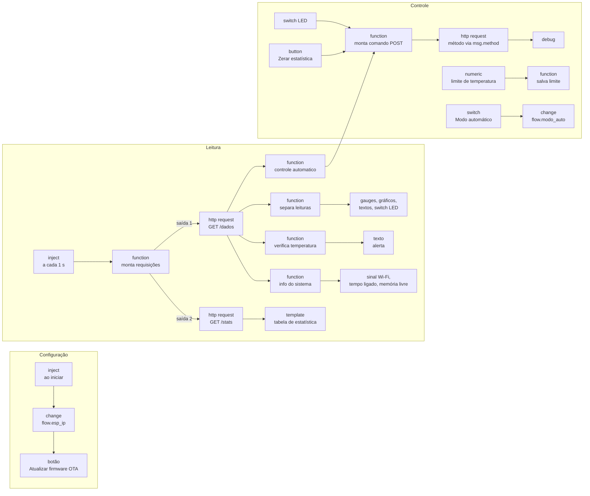

# T2 — Estação de monitoramento com ESP32 LoRa V2, BME280 e Node-RED

Estação de monitoramento ambiental baseada na placa **Heltec WiFi LoRa 32 V2** (ESP32) com o sensor **BME280**. O ESP32 lê temperatura, umidade e pressão, estima a altitude, calcula estatísticas das leituras e expõe tudo por uma **API HTTP**. Um painel no **Node-RED** consulta essa API, mostra os dados em tempo real e permite controlar a placa a distância. O firmware também pode ser atualizado pela rede (**OTA**), sem cabo USB.

---

## Sumário

1. [Visão geral](#1-visão-geral)
2. [Hardware](#2-hardware)
3. [Estrutura do repositório](#3-estrutura-do-repositório)
4. [Firmware do ESP32](#4-firmware-do-esp32)
5. [API HTTP](#5-api-http)
6. [Atualização remota (OTA)](#6-atualização-remota-ota)
7. [Interface no Node-RED](#7-interface-no-node-red)
8. [Como executar o projeto](#8-como-executar-o-projeto)
9. [Solução de problemas](#9-solução-de-problemas)

---

## 1. Visão geral



O funcionamento se divide em três partes:

| Parte | Quem faz | O que faz |
|---|---|---|
| **Aquisição** | ESP32 | Lê o BME280 a cada 1 s, acumula a estatística, monitora o botão e atualiza o display. |
| **Comunicação** | ESP32 (servidor) ↔ Node-RED (cliente) | O ESP32 responde requisições HTTP com JSON; o Node-RED pergunta a cada 1 s e envia comandos. |
| **Visualização e controle** | Node-RED | Mostra gauges, gráficos, contagem do botão, alerta de temperatura, informações do sistema e tabela de estatística; controla o LED manualmente ou conforme a temperatura, zera a estatística e oferece acesso à página OTA. |

O ESP32 funciona como **servidor**: ele não envia dados por conta própria, apenas responde quando alguém pede. Por isso qualquer cliente HTTP (Node-RED, navegador etc.) consegue consultar a placa usando as mesmas rotas.

---

## 2. Hardware

### Componentes

- Heltec WiFi LoRa 32 **V2** (ESP32 com rádio LoRa e display OLED 0,96" integrado)
- Sensor BME280 (módulo I2C, endereço `0x76`)
- Cabo USB (apenas para a primeira gravação; depois a atualização é feita via OTA)

### Pinagem

| Função | Pino (GPIO) | Observação |
|---|---|---|
| BME280 — SDA | 21 | Barramento I2C **secundário** (`TwoWire(1)`) |
| BME280 — SCL | 22 | |
| BME280 — VCC / GND | 3V3 / GND | |
| OLED — SDA | 4 | Barramento I2C **primário**, interno da placa |
| OLED — SCL | 15 | |
| OLED — RESET | 16 | Recebe um pulso LOW→HIGH na inicialização |
| LED | 25 | LED branco da placa |
| Botão | 0 | Botão **PRG** da placa (`INPUT_PULLUP`, ativo em LOW) |

O sensor e o display ficam em **barramentos I2C separados**: o display usa o barramento interno da placa (4/15) e o BME280 usa um segundo barramento (21/22).

---

## 3. Estrutura do repositório

```
T2_RIC/
├── Codigo_esp/                  Projeto PlatformIO do firmware
│   ├── platformio.ini           Placa, framework, bibliotecas e flags de compilação
│   └── src/
│       └── main.cpp             Código completo do ESP32
├── Node-Red-Interface/
│   └── node-red.json            Fluxo do Node-RED (para importar)
└── README.md
```

---

## 4. Firmware do ESP32

O firmware foi desenvolvido no **PlatformIO** (framework Arduino) e está todo em `Codigo_esp/src/main.cpp`.

### 4.1 Bibliotecas

Declaradas em `platformio.ini` e baixadas automaticamente pelo PlatformIO:

| Biblioteca | Uso no projeto |
|---|---|
| `ESP32Async/ESPAsyncWebServer` | Servidor HTTP assíncrono (as rotas da API) |
| `ESP32Async/AsyncTCP` | Camada TCP usada pelo servidor assíncrono |
| `bblanchon/ArduinoJson` (v7) | Montagem das respostas em JSON |
| `ayushsharma82/ElegantOTA` | Página `/update` para atualização do firmware pela rede |
| `adafruit/Adafruit BME280 Library` | Leitura do sensor BME280 |
| `thingpulse/ESP8266 and ESP32 OLED driver for SSD1306 displays` | Display OLED da placa |

A flag `-DELEGANTOTA_USE_ASYNC_WEBSERVER=1` no `platformio.ini` informa à ElegantOTA que o servidor do projeto é o **assíncrono** (`ESPAsyncWebServer`). Sem ela, a biblioteca é compilada para o servidor síncrono (`WebServer.h`) e o código não compila. A flag precisa ir no `build_flags` (e não num `#define` no `main.cpp`) porque precisa valer também para os arquivos da própria biblioteca.

### 4.2 Configurações

No topo do `main.cpp` ficam todas as constantes ajustáveis:

| Constante | Função |
|---|---|
| `WIFI_SSID`, `WIFI_PASS` | Rede Wi-Fi à qual o ESP32 se conecta |
| `OTA_HOSTNAME`, `OTA_SENHA` | Usuário e senha da página de atualização `/update` |
| `FW_VERSAO` | Versão do firmware, mostrada no display e no dashboard |
| `SEALEVELPRESSURE_HPA` | Pressão de referência ao nível do mar, usada no cálculo da altitude |
| `INTERVALO_LEITURA` | Intervalo entre leituras do sensor (1000 ms) |
| `DEBOUNCE_MS` | Tempo de estabilização do botão (50 ms) |

> **Dica:** altere `FW_VERSAO` a cada nova gravação. Como a versão aparece no dashboard, isso comprova que a atualização via OTA funcionou.

### 4.3 Inicialização (`setup()`)

A inicialização segue esta ordem:

1. **Serial** a 115200 baud, para acompanhar o boot pelo monitor serial.
2. **LED e botão:** LED como saída (começa desligado) e botão como entrada com pull-up interno.
3. **Display OLED:** pulso no pino de reset (16) e inicialização. Se falhar, o firmware segue funcionando sem display (`displayOk = false`).
4. **BME280:** inicia o barramento I2C secundário (21/22, 100 kHz) e procura o sensor no endereço `0x76`. Se não encontrar, segue funcionando e envia valores zerados (`sensorOk = false`).
5. **Wi-Fi:** modo estação, com reconexão automática ativada. Se não conectar em **20 s**, a placa reinicia e tenta de novo.
6. **NTP:** sincroniza o relógio (fuso UTC−3) para registrar o horário de início da estatística. Espera no máximo **10 s**; sem internet, segue sem hora certa.
7. **Servidor HTTP:** registra as rotas (`configurarRotas()`) e inicia o servidor na porta 80.
8. Faz a **primeira leitura** do sensor, atualiza o display e imprime o endereço de acesso no monitor serial.

O display e o sensor são inicializados **antes** do Wi-Fi para que o display já mostre o andamento da inicialização. Depois do boot, ele mostra o **IP da placa**, que é o endereço usado no Node-RED.

### 4.4 Laço principal (`loop()`)

```cpp
void loop() {
    ElegantOTA.loop();     // trata a atualização OTA quando houver
    atualizarBotao();      // verifica o botão a cada volta (com debounce)

    unsigned long agora = millis();
    if (agora - tempoAnteriorLeitura >= INTERVALO_LEITURA) {   // a cada 1 s
        tempoAnteriorLeitura = agora;
        ultimaLeitura = readSensorBME();
        if (sensorOk) acumularEstatisticas(ultimaLeitura);
        atualizarDisplay();
    }
}
```

Não há nenhum `delay()` no laço: o tempo é controlado com `millis()`. Assim o botão é verificado continuamente e o servidor e a OTA continuam respondendo enquanto o programa aguarda a próxima leitura.

### 4.5 Leitura do sensor e grandezas derivadas

`readSensorBME()` devolve uma estrutura `DadosBME` com:

- **Temperatura** (°C) e **umidade relativa** (%): lidas diretamente do BME280.
- **Pressão** (hPa): o sensor fornece em Pa; o código divide por 100.
- **Altitude estimada** (m): calculada pela biblioteca a partir da pressão medida $P$ e da pressão de referência ao nível do mar $P_0$ (`SEALEVELPRESSURE_HPA`):

$$h = 44330 \cdot \left[1 - \left(\frac{P}{P_0}\right)^{0{,}1903}\right]$$

### 4.6 Botão com debounce

Um botão mecânico "trepida" por alguns milissegundos ao ser pressionado, gerando várias transições falsas. A função `atualizarBotao()` só aceita uma mudança de estado depois que a leitura fica estável por `DEBOUNCE_MS` (50 ms). A contagem `botaoContagemPressoes` aumenta apenas na transição **solto → pressionado**, então segurar o botão conta como um único toque.

### 4.7 Análise estatística incremental

Para cada variável (temperatura, umidade, pressão e altitude) o firmware calcula **média, desvio padrão, mínimo e máximo** considerando **todas as leituras desde o início** (ou desde o último reset). A cada nova leitura a estatística é recalculada com uma amostra a mais: com 26 leituras, a análise usa as 26; na leitura seguinte, usa as 27, e assim por diante.

Guardar todas as leituras na memória do ESP32 seria inviável, então o código usa o **algoritmo de Welford**, implementado na `struct Estatistica`. Ele atualiza a média e a soma dos quadrados dos desvios ($M_2$) a cada nova amostra $x$, sem armazenar o histórico:

$$\delta = x - \bar{x}_{n-1} \qquad \bar{x}_n = \bar{x}_{n-1} + \frac{\delta}{n} \qquad M_{2,n} = M_{2,n-1} + \delta\,(x - \bar{x}_n)$$

O desvio padrão amostral é então:

$$s = \sqrt{\frac{M_2}{n-1}}$$

Vantagens desse método:
- usa memória constante (5 variáveis por grandeza), não importa quantas leituras já foram feitas;
- é numericamente estável. A fórmula ingênua $\sum x^2 - n\bar{x}^2$ perde precisão quando os valores são grandes e variam pouco, como a pressão (~950 hPa variando décimos).

Mínimo e máximo são atualizados por comparação simples. O horário da primeira amostra é guardado em `horaInicioJanela`. A rota `POST /stats/reset` zera tudo e recomeça a contagem.

### 4.8 Display OLED

`atualizarDisplay()` é chamada a cada leitura e mostra:

```
IP: 192.168.x.x
T: 24.6 C   U: 59 %
P: 957.9 hPa
Alt: 607 m
LED OFF   fw 1.0.2
```

### 4.9 Servidor HTTP assíncrono

O projeto usa o **ESPAsyncWebServer**, em que cada requisição é tratada por uma tarefa separada (do AsyncTCP), sem bloquear o `loop()`.

Por isso há uma regra de projeto importante: o sensor é lido uma vez no `setup()` e depois no `loop()`; **as rotas HTTP não fazem leituras do sensor**. Elas apenas consultam a última leitura guardada na variável global `ultimaLeitura`. Se uma rota também lesse o BME280, as duas tarefas poderiam acessar o barramento I2C ao mesmo tempo e corromper a comunicação. Também não há `delay()` dentro das rotas.

---

## 5. API HTTP

O ESP32 responde na porta 80, no IP mostrado no display e no monitor serial.

| Método | Rota | Descrição |
|---|---|---|
| `GET` | `/dados` | Leitura atual do sensor e estado da placa |
| `GET` | `/stats` | Estatística acumulada (média, desvio padrão, mínimo, máximo) |
| `POST` | `/stats/reset` | Zera a estatística e a contagem do botão |
| `POST` | `/led?estado=1` ou `/led?estado=0` | Liga ou desliga o LED |
| `POST` | `/reiniciar` | Reinicia o ESP32 |
| `GET` | `/update` | Página de atualização do firmware (OTA), com login |
| — | qualquer outra | `404 Rota nao encontrada` |

### `GET /dados`

```json
{
  "sensor_ok": true,
  "temperatura": 24.62,
  "umidade": 59.71,
  "pressao": 957.88,
  "altitude": 607.4,
  "botao": false,
  "toques_botao": 3,
  "led": false,
  "rssi": -61,
  "uptime_s": 842,
  "heap_livre": 214532,
  "ip": "10.155.221.110",
  "versao": "1.0.2"
}
```

| Campo | Significado |
|---|---|
| `sensor_ok` | `false` se o BME280 não foi encontrado (nesse caso as leituras vêm zeradas) |
| `temperatura`, `umidade`, `pressao`, `altitude` | Última leitura (°C, %, hPa, m) |
| `botao` | Estado atual do botão (`true` = pressionado) |
| `toques_botao` | Quantas vezes o botão foi pressionado desde o início/último reset |
| `led` | Estado atual do LED |
| `rssi` | Intensidade do sinal Wi-Fi (dBm; quanto mais perto de 0, melhor) |
| `uptime_s` | Tempo desde que a placa ligou (s) |
| `heap_livre` | Memória RAM livre (bytes) |
| `ip`, `versao` | IP da placa e versão do firmware |

### `GET /stats`

```json
{
  "amostras": 47,
  "inicio": "2026-10-12 17:28:21",
  "toques_botao": 3,
  "temperatura": { "media": 24.54, "dp": 0.30, "min": 23.96, "max": 25.12 },
  "umidade":     { "media": 58.80, "dp": 0.80, "min": 57.70, "max": 60.50 },
  "pressao":     { "media": 957.84, "dp": 0.09, "min": 957.69, "max": 958.04 },
  "altitude":    { "media": 607.7, "dp": 0.75, "min": 606.0, "max": 609.1 }
}
```

`amostras` é o número de leituras usadas no cálculo. Ele cresce de um em um (uma leitura por segundo).

### `POST /led?estado=1`

```json
{ "led": true }
```

Sem o parâmetro `estado`, a resposta é `400` com a mensagem `Use /led?estado=0 ou /led?estado=1`.

### `POST /stats/reset`

```json
{ "ok": true }
```

### `POST /reiniciar`

```json
{ "reiniciando": true }
```

O reinício é solicitado no callback `onDisconnect`, quando a conexão HTTP do cliente é encerrada. O momento exato depende de quando o cliente desconecta.

---

## 6. Atualização remota (OTA)

OTA (*Over-The-Air*) permite gravar um novo firmware pela rede Wi-Fi, sem conectar a placa ao computador. O projeto usa a biblioteca **ElegantOTA**, que adiciona a página `/update` ao mesmo servidor HTTP da API.

**Como atualizar:**

1. No VS Code / PlatformIO, faça a alteração no código (por exemplo, mude `FW_VERSAO`) e clique em **Build**.
2. O arquivo gerado fica em `Codigo_esp/.pio/build/heltec_wifi_lora_32_V2/firmware.bin`.
3. No navegador, acesse `http://IP-DO-ESP/update` ou use o botão **Atualizar firmware (OTA)** no dashboard do Node-RED.
4. Faça login: o usuário é o valor de `OTA_HOSTNAME` e a senha é o valor de `OTA_SENHA`.
5. Selecione **Firmware**, escolha o `firmware.bin` e aguarde o envio. A placa reinicia sozinha com o novo código.
6. Confira a nova versão no dashboard do Node-RED ou no display.

> A **primeira gravação** precisa ser feita pelo cabo USB, já que a placa só aceita OTA depois que estiver rodando um firmware que tenha OTA.

---

## 7. Interface no Node-RED

O dashboard foi feito com o pacote **node-red-dashboard**. O fluxo completo está em `Node-Red-Interface/node-red.json`.

### 7.1 Como o fluxo funciona



**1. Configuração.** Ao iniciar o Node-RED, um `inject` dispara uma vez e o nó **IP do ESP** guarda o endereço em `flow.esp_ip`. As funções que montam requisições e o botão OTA usam esse IP. No arquivo importado, ele está configurado como `10.155.221.110`; troque pelo IP mostrado na sua placa.

**2. Leitura.** A cada 1 s, um `inject` aciona a função **monta requisições**, que gera duas mensagens: uma com a URL de `/dados` (saída 1) e outra com a de `/stats` (saída 2). Os dois nós `http request` estão com a URL em branco e usam o `msg.url` montado pela função. O `requestTimeout` de 2 s faz a requisição desistir rápido se a placa estiver desligada.

A função **separa leituras** recebe o JSON de `/dados` e o distribui por **11 saídas**, uma para cada widget:

| Saída | Destino | Conteúdo |
|---|---|---|
| 1, 2, 3 | Gauges | Temperatura, umidade e pressão |
| 4, 5, 6 | Gráficos | Os mesmos valores, com `topic` para nomear a série |
| 7 | Texto | Quantas vezes o botão foi pressionado |
| 8 | Texto | Estado do botão (Pressionado/Solto) |
| 9 | Texto | Status da conexão e versão do firmware |
| 10 | Switch do LED | Estado real do LED, para manter o switch sincronizado |
| 11 | Gráfico | Altitude estimada (m) |

Se o ESP não responder (`statusCode` diferente de 200), a função atualiza apenas o status para **🔴 Offline** e mantém os demais widgets como estavam.

O nó **verifica temperatura** recebe a mesma resposta de `/dados` e atualiza o aviso no dashboard. Ele mostra **ALERTA** quando a temperatura é maior ou igual ao limite, **Normal** quando está abaixo dele e informa falha de conexão ou sensor. O limite começa em **30 °C** e pode ser ajustado no widget **Limite de temperatura (°C)**, entre 0 e 50 °C, em passos de 0,5 °C. O valor fica no contexto do fluxo Node-RED e o `inject` de inicialização o redefine para 30 °C ao iniciar.

O nó **info do sistema** também recebe `/dados`: mostra o sinal Wi-Fi (`rssi`, em dBm), o tempo ligado (`uptime_s`, formatado em dias/horas/minutos/segundos) e a memória livre (`heap_livre`, convertida para kB). Sem resposta HTTP válida, os dois textos passam a `—`; o gauge do sinal mantém a última leitura.

O JSON de `/stats` vai direto para o nó **template**, que monta a tabela em HTML usando as expressões do AngularJS (por exemplo, `{{msg.payload.temperatura.media | number:2}}`).

**3. Controle.** O switch do LED (tópico `led`, valores `"1"`/`"0"`) e o botão **Zerar estatística** (tópico `stats/reset`) enviam mensagens para a função **monta comando POST**, que define `msg.method = 'POST'` e monta a URL a partir do tópico:

- `led` → `http://IP/led?estado=1` (ou `0`)
- `stats/reset` → `http://IP/stats/reset`

O `http request` está configurado com o método *"definido por msg.method"*, e a resposta do ESP aparece no nó `debug`.

O switch tem a opção *"pass through"* **desativada**. Assim, quando a saída 10 atualiza o switch com o estado real do LED, ele não envia um novo comando de volta para a placa.

O switch **Modo automático** grava `true`/`false` em `flow.modo_auto`. Quando ativado e o sensor está disponível, a função **controle automatico** usa cada resposta de `/dados` para ligar o LED ao atingir o limite de temperatura e desligá-lo quando a temperatura cai **abaixo de (limite − 0,5 °C)**. Essa margem evita alternância rápida perto do limite. Ela envia comandos apenas quando o estado do LED precisa mudar; um comando manual pode ser revertido na próxima consulta enquanto o modo automático estiver ativo. Esse controle depende do Node-RED em execução.

O botão **Atualizar firmware (OTA)** abre `http://IP-DO-ESP/update` em outra aba do navegador, usando o IP configurado no nó **IP do ESP**.

### 7.2 Layout do dashboard

O dashboard tem uma aba, **Estação ESP**, com quatro grupos:

| Grupo | Conteúdo |
|---|---|
| **Leitura de dados** | Gauges de temperatura (0–50 °C), umidade (0–100 %) e pressão (900–1050 hPa); gráficos de linha de temperatura, umidade e pressão com janela de 10 minutos, e de altitude com janela de 10 horas; contagem e estado do botão |
| **Controle do ESP** | Status da conexão (online/offline e versão do firmware), switch manual do LED, switch do modo automático, ajuste do limite de temperatura, aviso de alerta e botão OTA |
| **Análise estatística** | Tabela com número de amostras, horário de início, e média, desvio padrão, mínimo e máximo de temperatura, umidade, pressão e altitude; botão para zerar a estatística |
| **Informações do sistema** | Gauge do sinal Wi-Fi (−100 a −30 dBm), tempo ligado e memória livre em kB |

---

## 8. Como executar o projeto

### 8.1 Gravar o firmware

1. Instale o **VS Code** com a extensão **PlatformIO IDE**.
2. Abra a pasta `Codigo_esp` no VS Code. As bibliotecas são baixadas automaticamente na primeira compilação.
3. Em `src/main.cpp`, ajuste `WIFI_SSID` e `WIFI_PASS` para a sua rede.
4. Conecte a placa pelo USB e clique em **Upload** (→ na barra inferior).
5. Abra o **Serial Monitor** (115200 baud). Deve aparecer:
   ```
   Display OLED - OK!
   Sensor BME280 - OK
   Conectando.....
   IP address: 192.168.x.x
   Sincronizando hora via NTP... OK -> 2026-10-12 17:28:20
   Pronto! Dados em http://192.168.x.x/dados
   ```
6. Teste no navegador: `http://192.168.x.x/dados` deve exibir o JSON com as leituras.

### 8.2 Configurar o Node-RED

1. Instale o [Node.js](https://nodejs.org) (versão LTS) e o Node-RED:
   ```
   npm install -g --unsafe-perm node-red
   ```
2. Inicie com o comando `node-red` e acesse `http://localhost:1880`.
3. Menu ☰ → **Gerenciar paleta** → **Instalar** → `node-red-dashboard`.
4. Menu ☰ → **Importar** → selecione `Node-Red-Interface/node-red.json` → **Importar**.
5. Abra o nó **IP do ESP** na seção de configuração e troque `10.155.221.110` pelo IP mostrado no display ou no monitor serial.
6. Clique em **Implementar**.
7. Acesse o dashboard em `http://localhost:1880/ui`.
8. No grupo **Controle do ESP**, ajuste **Limite de temperatura (°C)**. Para testar o alerta, escolha um limite abaixo da temperatura medida e depois um acima dela.
9. Se quiser que o LED acompanhe esse limite, ative **Modo automático**. Para atualizar o firmware, use **Atualizar firmware (OTA)** e selecione o arquivo `.bin` compilado pelo PlatformIO.

O computador com o Node-RED e o ESP32 precisam estar **na mesma rede**.

---

## 9. Solução de problemas

| Sintoma | Causa provável | Solução |
|---|---|---|
| Status **🔴 Offline** no dashboard | IP errado no nó "IP do ESP", ou PC e ESP em redes diferentes | Confira o IP no display/monitor serial e teste `http://IP/dados` no navegador |
| Monitor serial mostra `Wi-Fi falhou, reiniciando...` | SSID/senha errados ou rede fora de alcance | Corrija `WIFI_SSID`/`WIFI_PASS`; o ESP32 só conecta em redes de 2,4 GHz |
| `"sensor_ok": false` e valores zerados | BME280 não encontrado | Confira a ligação SDA (21) / SCL (22) e a alimentação; alguns módulos usam o endereço `0x77` |
| Horário de início da estatística em 1970 | Sem acesso à internet no boot (NTP falhou) | Não afeta as medições; com internet, o horário é sincronizado na próxima inicialização |
| Erro de compilação em `ElegantOTA.begin` | Falta a flag do servidor assíncrono | Confira `build_flags = -DELEGANTOTA_USE_ASYNC_WEBSERVER=1` no `platformio.ini` |
| Página `/update` recusa o login | Usuário/senha incorretos | Usuário = `OTA_HOSTNAME`, senha = `OTA_SENHA` |
| Widget não aparece no dashboard | Nó sem grupo selecionado | Edite o nó e selecione o grupo correto |
